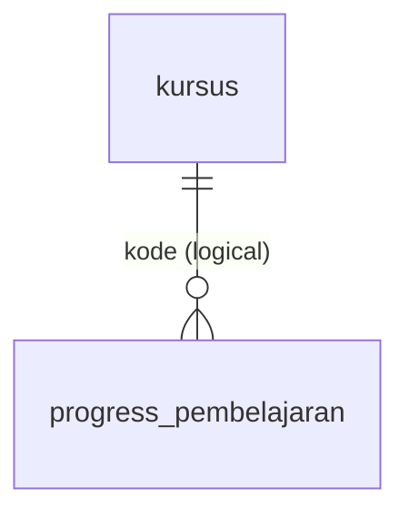

# DB Schema: web-ai-center2
## Meta
engine: PostgreSQL (PGlite for dev) | orm: drizzle-orm 0.45 | source: server/drizzle/0000_calm_sersi.sql, 0001_remarkable_rictor.sql, 0002_tearful_dormammu.sql, 0003_great_zeigeist.sql, 0004_pretty_salo.sql (cross-check: server/src/db/schema.ts) | tables: 11
## Legend
PK=PRIMARY KEY | FK=FOREIGN KEY | NOT NULL | UNIQUE | DEFAULT | types are copied verbatim from migration SQL (PostgreSQL) | "# note"=comment, not part of the DB
## Tables
berita(id serial PK NOT NULL, slug text NOT NULL UNIQUE, judul text NOT NULL, ringkasan text NOT NULL, isi text NOT NULL, tanggal date NOT NULL, gambar text, penulis text NOT NULL, created_at timestamp NOT NULL DEFAULT now())
dokumentasi(id serial PK NOT NULL, slug text NOT NULL UNIQUE, judul text NOT NULL, deskripsi text NOT NULL, tanggal date NOT NULL, kategori text NOT NULL, gambar text, created_at timestamp NOT NULL DEFAULT now())
hero_slides(id serial PK NOT NULL, urutan integer NOT NULL DEFAULT 0, eyebrow text NOT NULL, judul text NOT NULL, judul_aksen text NOT NULL, sub text NOT NULL, cta_primer jsonb NOT NULL, cta_sekunder jsonb NOT NULL, badge_judul text NOT NULL, badge_sub text NOT NULL, image text, src_set text, sizes text, layout text)  # cta_*: {label,to}; layout added in 0002
klien(id serial PK NOT NULL, nama text NOT NULL, bidang text NOT NULL, urutan integer NOT NULL DEFAULT 0)
layanan(id serial PK NOT NULL, slug text NOT NULL UNIQUE, nama text NOT NULL, tagline text NOT NULL, deskripsi text NOT NULL, fitur jsonb NOT NULL)  # fitur: string[]
profil(id integer PK NOT NULL, nama text NOT NULL, tagline text NOT NULL, ringkasan text NOT NULL, alamat text NOT NULL, email text NOT NULL, telepon text NOT NULL, visi text, misi text, statistik jsonb)  # singleton row id=1; statistik: {label,value}[]
testimoni(id serial PK NOT NULL, nama text NOT NULL, peran text NOT NULL, kutipan text NOT NULL, urutan integer NOT NULL DEFAULT 0)
tim(id serial PK NOT NULL, nama text NOT NULL, peran text NOT NULL, kredensial text, foto text, urutan integer NOT NULL DEFAULT 0)
kursus(id serial PK NOT NULL, kode text NOT NULL UNIQUE, target jsonb NOT NULL, judul text NOT NULL, deskripsi text NOT NULL, tentang text NOT NULL, durasi text NOT NULL, level text NOT NULL, format text NOT NULL, instruktur text NOT NULL, peran text NOT NULL, inisial text NOT NULL, hasil jsonb NOT NULL, modul jsonb NOT NULL, urutan integer NOT NULL DEFAULT 0)  # target,hasil: string[]; modul: {judul,deskripsi,meta,video?,quiz?}[]
inference(id integer PK NOT NULL, judul_apa_itu text NOT NULL, deskripsi_apa_itu text NOT NULL, kebutuhan jsonb NOT NULL, alur jsonb NOT NULL, contoh_intro text NOT NULL, contoh jsonb NOT NULL)  # legacy, unused
progress_pembelajaran(peserta_id text NOT NULL, kode text NOT NULL, state jsonb NOT NULL, diperbarui_pada timestamp NOT NULL DEFAULT now(), PK(peserta_id, kode))
## Enums
none
## Relations
kursus 1—N progress_pembelajaran (progress_pembelajaran.kode → kursus.kode, logical, no FK)
## ERD

## Gaps
- ? progress_pembelajaran.kode → kursus.kode has no FK constraint (server/drizzle/0004_pretty_salo.sql)
- ? hero_slides.layout is TS union 'default'|'image-left'|'teks-kanan' only, no DB enum/CHECK (server/src/db/schema.ts, server/drizzle/0002_tearful_dormammu.sql)
- ? inference is legacy, no route/seed writes it (server/src/db/schema.ts)
- ? PostgreSQL version unstated; no docker-compose, DB external (server/DEPLOY.md)
- ? drizzle/meta snapshots not compared; SQL files and schema.ts agree on all column names/types checked
