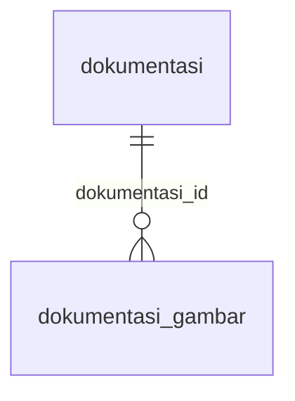

# DB Schema Baru: web-ai-center2 (backend Go)

## Meta
engine: PostgreSQL 15 | database: `ai_center` (dev), `ai_center_test` (tes) | migrasi: goose v3.29.0 (`backend/migrations/00001_skema_awal.sql`, versi 1; hanya 00001 yang dipakai sampai ada data nyata) | ekstensi: `pg_trgm` 1.6 | akses data: pgx + sqlc (query publik dan admin berita) | tables: 5 (+ `goose_db_version`) | tanggal: 2026-11-09
Rancangan: `docs/database.md` §3-§4 plus keputusan sesi desain (dicatat di `perubahan-kode.md`). Isi di bawah dicocokkan dengan database yang terbentuk (`information_schema`, `pg_constraint`, `pg_indexes`), bukan hanya dengan berkas migrasi.
Skema BARU, terpisah dari skema lama (`Schema.md`, database `mydb`, tidak disentuh).

## Legend
PK=PRIMARY KEY | FK=FOREIGN KEY | NN=NOT NULL | UQ=UNIQUE | DEF=DEFAULT | "gen"=generated column. Semua `timestamptz` disimpan UTC (ISO 8601 pada API). Nilai `status`: `draft` / `posted` (mengikuti docs).

## Tabel

**berita**
| Kolom | Tipe | Aturan | Catatan |
| ----- | ---- | ------ | ------- |
| `id` | bigint | PK, identity | |
| `slug` | text | NN, UQ | dibuat saat simpan pertama; bentrok diberi akhiran `-2`, `-3`; tidak berubah |
| `judul` | text | NN | |
| `ringkasan` | text | gen STORED | `left(split_part(isi, E'\n\n', 1), 200)`: paragraf pertama `isi`, maksimal 200 karakter; tidak diisi editor; mengubah 200 butuh migrasi |
| `isi` | text | NN | teks biasa; paragraf dipisah `\n\n` |
| `tanggal_publikasi` | date | NN | dipilih editor di form admin, wajib sejak simpan pertama (mengikuti `database.md` §3.1 dan `requirement.md` §5.1); tampil `DD-MM-YYYY` |
| `gambar` | text | NN, UQ | key RustFS `berita/{uuid}.ext` (tanpa `{id}`, lihat catatan di bawah) |
| `status` | text | NN, DEF `'draft'`, CHECK | |
| `version` | integer | NN, DEF `1`, CHECK `>= 1` | optimistic locking |
| `created_at` | timestamptz | NN, DEF `now()` | pemutus seri urutan tampil |
| `created_by`, `updated_by` | text | NN | `sub` dari session |
| `deleted_at` | timestamptz | null | waktu masuk trash |

**dokumentasi**: kolom sama seperti berita, kecuali tidak ada `ringkasan`, `isi`, dan `gambar` (gambar ada di `dokumentasi_gambar`). `judul` = judul kegiatan. `tanggal_publikasi` juga date, NN, dipilih editor (`requirement.md` §5.2).

**dokumentasi_gambar**
| Kolom | Tipe | Aturan | Catatan |
| ----- | ---- | ------ | ------- |
| `id` | bigint | PK, identity | |
| `dokumentasi_id` | bigint | NN, FK → `dokumentasi.id` ON DELETE CASCADE | |
| `key` | text | NN, UQ | key RustFS `dokumentasi/{uuid}.ext` |
| `urutan` | smallint | NN, CHECK `1..6` | 1 = headline |
| `alt` | text | null | NULL: frontend memakai judul dokumentasi. Caption belum dibuat |
| | | UQ (`dokumentasi_id`, `urutan`) `DEFERRABLE INITIALLY DEFERRED` | `urutan` bisa dirapikan 1..n dalam satu transaksi |

**testimoni**
| Kolom | Tipe | Aturan | Catatan |
| ----- | ---- | ------ | ------- |
| `id` | bigint | PK, identity | |
| `nama`, `teks`, `posisi` | text | NN | |
| `foto` | text | null, UQ | key RustFS `testimoni/{uuid}.ext` |
| `status`, `version`, `created_at`, `created_by`, `updated_by`, `deleted_at` | | sama seperti berita | tanpa kolom `urutan` dan tanpa `tanggal_publikasi`; urutan tampil = `created_at` terbaru di atas |

**tim** (tanpa status dan tanpa trash; hapus langsung permanen)
| Kolom | Tipe | Aturan | Catatan |
| ----- | ---- | ------ | ------- |
| `id` | bigint | PK, identity | |
| `nama`, `posisi`, `bidang_riset` | text | NN | |
| `foto` | text | NN, UQ | key RustFS `tim/{uuid}.ext` |
| `urutan` | integer | NN | urutan tampil manual |
| `version` | integer | NN, DEF `1`, CHECK `>= 1` | |
| `created_at` | timestamptz | NN, DEF `now()` | |
| `created_by`, `updated_by` | text | NN | |

## Index (selain PK)
| Index | Tabel | Definisi | Untuk |
| ----- | ----- | -------- | ----- |
| `berita_slug_key`, `dokumentasi_slug_key` | berita, dokumentasi | UNIQUE (`slug`) | detail by slug |
| `dokumentasi_gambar_urutan_unik` | dokumentasi_gambar | UNIQUE (`dokumentasi_id`, `urutan`) | urutan gambar; juga melayani FK |
| `berita_gambar_key` | berita | UNIQUE (`gambar`) | satu key gambar hanya boleh dipakai satu berita (pengaman terakhir; pemeriksaan utama di aplikasi) |
| `dokumentasi_gambar_key_key` | dokumentasi_gambar | UNIQUE (`key`) | satu key hanya dipakai satu baris gambar dokumentasi |
| `testimoni_foto_key` | testimoni | UNIQUE (`foto`) | satu key foto hanya dipakai satu testimoni (NULL boleh banyak) |
| `tim_foto_key` | tim | UNIQUE (`foto`) | satu key foto hanya dipakai satu anggota tim |
| `berita_terbit_idx`, `dokumentasi_terbit_idx` | berita, dokumentasi | (`tanggal_publikasi` DESC, `created_at` DESC) WHERE `status='posted' AND deleted_at IS NULL` (parsial) | daftar publik terbaru |
| `berita_judul_trgm_idx`, `dokumentasi_judul_trgm_idx` | berita, dokumentasi | GIN (`judul` `gin_trgm_ops`) | pencarian `ILIKE '%q%'` |
| `berita_trash_idx`, `dokumentasi_trash_idx`, `testimoni_trash_idx` | berita, dokumentasi, testimoni | (`deleted_at`) WHERE `deleted_at IS NOT NULL` (parsial) | job hapus otomatis trash 30 hari |

Ditunda: index untuk daftar admin (mis. `(status, created_at DESC)`), sampai terbukti perlu. Keputusan index mengikuti `database.md` §9 (masih `[diisi]` di docs; usulan pengguna dan penyesuaian sesi desain).

### Hasil EXPLAIN ANALYZE (2026-11-05)
Diuji di `ai_center_test` dengan 20.000 baris berita (14.000 `posted`, 1.000 di-trash) dan 20.000 dokumentasi tiruan, `ANALYZE` dijalankan; data uji sudah dihapus (`TRUNCATE`). Angka di tabel dari uji pertama (urutan `tanggal_publikasi, id`). Setelah index diubah ke `(tanggal_publikasi DESC, created_at DESC)` sesuai pemutus seri di docs, daftar publik diuji ulang: halaman 1 = 0,22 ms dan halaman 500 = 3,0 ms, tetap Index Scan `berita_terbit_idx`.
| Kueri | Rencana | Waktu eksekusi |
| ----- | ------- | -------------- |
| Daftar publik halaman 1 (LIMIT 9) | Index Scan `berita_terbit_idx` | 0,27 ms |
| Daftar publik halaman 500 (OFFSET 4491) | Index Scan `berita_terbit_idx` (membaca 4.500 baris) | 2,7 ms |
| Pencarian kata umum "inference" | Index Scan `berita_terbit_idx` + filter (cepat karena banyak cocok) | 0,36 ms |
| Pencarian kata jarang "a1b2c3" | Bitmap Index Scan `berita_judul_trgm_idx` | 1,3 ms |
| Pencarian 2 karakter "zz" | Seq Scan (trigram tidak berlaku) | 35,7 ms |
| Job purge trash > 30 hari | Bitmap Index Scan `berita_trash_idx` | 0,9 ms |
| Detail by slug | Index Scan `berita_slug_key` | 0,04 ms |
| Dokumentasi daftar publik | Index Scan `dokumentasi_terbit_idx` | 0,06 ms |

Catatan: OFFSET dalam membaca semua baris yang dilewati (2,7 ms pada halaman 500). Cukup untuk volume CMS dan terlindungi cache Redis. Pencarian 2 karakter memindai tabel dan di sini masih puluhan milidetik pada 20 ribu baris.

## ERD

`berita`, `testimoni`, dan `tim` berdiri sendiri (gambar disimpan sebagai key di kolomnya).

Catatan key gambar (2026-11-09): format key adalah `{sumber}/{uuid-v4}.{jpg|png|webp}` tanpa `{id}`, karena file diunggah sebelum barisnya ada. Ini menyimpang dari `database.md` §5 (`{sumber}/{id}/{uuid}.ext`), keputusan pengguna. Kolom UNIQUE di atas ditambahkan dengan menulis ulang `00001_skema_awal.sql` (belum ada data nyata); semua constraint cocok dengan `pg_constraint` di `ai_center` dan `ai_center_test`.

## Perbedaan dari skema lama (`Schema.md`)
- Dihapus: `kursus`, `progress_pembelajaran`, `hero_slides`, `klien`, `layanan`, `profil`, `inference`.
- `berita`: `penulis` dihapus; `tanggal` (date) menjadi `tanggal_publikasi` (date, tetap dipilih editor); `ringkasan` tetap ada tetapi menjadi kolom turunan dari `isi`.
- `dokumentasi`: `deskripsi`, `kategori`, `gambar` dihapus; gambar pindah ke `dokumentasi_gambar`.
- `testimoni`: `kutipan` menjadi `teks`, `peran` menjadi `posisi`; `urutan` dihapus.
- `tim`: `peran` menjadi `posisi`, `kredensial` menjadi `bidang_riset`.
- Baru: `status`, `version`, `created_by`, `updated_by`, `deleted_at` (berita, dokumentasi, testimoni; `tim` hanya `version`, `created_by`, `updated_by`), sesuai `database.md` §3; `id` dari `serial` menjadi `bigint identity`; waktu dari `timestamp` menjadi `timestamptz`.

## Gaps (belum diputuskan atau perlu disesuaikan di `docs/`)
- ? Awal `database.md` §3.1 terpotong (kolom `id`, `slug`, `judul`, `isi` tidak tertulis); strukturnya diambil dari database lama dan disesuaikan.
- ? Batas panjang teks tidak diberi CHECK di DB; divalidasi di aplikasi (angka dicatat di `perubahan-kode.md`).
- ? Aturan "gambar dokumentasi minimal 1" ditegakkan di aplikasi, bukan constraint DB.
- ? Pola key tanpa `{id}` menyimpang dari `database.md` §5 (lihat catatan key gambar di atas).
- ? Tidak ada `updated_at` dan `deleted_by` (mengikuti docs). Bila ETag/`lastmod` sitemap atau audit penghapusan membutuhkannya kelak, perlu diputuskan lagi (ETag bisa memakai `version`).
